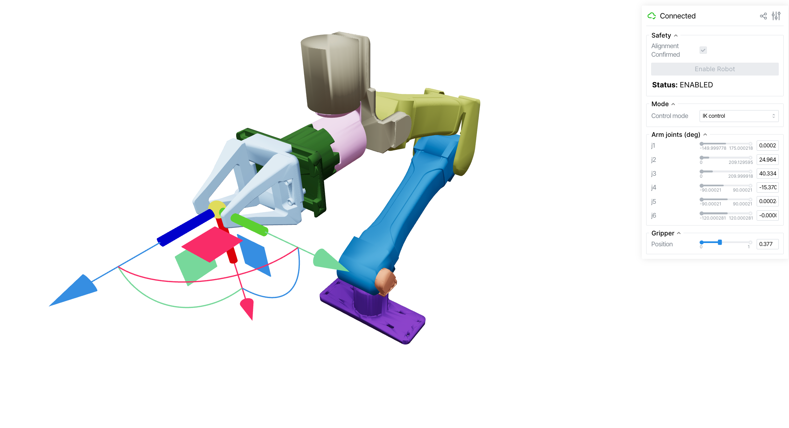

# Viser Control Interface

Browser-based 3D visualization and control interface for i2rt robots, powered by [viser](https://github.com/nerfstudio-project/viser).



## Quick Start

```bash
# Simulation mode (no hardware required)
python examples/control_with_viser/control_with_viser.py --sim

# Real robot on CAN bus
python examples/control_with_viser/control_with_viser.py --channel can0

# Real robot through an EtherCAT-to-CAN board on NIC enp99s0
python examples/control_with_viser/control_with_viser.py --arm yam_7dof_right --channel ecat:enp99s0

# Specify arm and gripper variants
python examples/control_with_viser/control_with_viser.py --arm big_yam --gripper linear_4310 --sim

# 7-DOF arm, left side
python examples/control_with_viser/control_with_viser.py --arm yam_7dof_left --sim

# End effector on its own, no arm
python examples/control_with_viser/control_with_viser.py --arm no_arm --gripper yam_teaching_handle_v2
```

Then open `http://localhost:8080` in your browser.

## Gripper-only (`--arm no_arm`)

Drops the arm and shows just the end effector — useful for bench-testing one on its own CAN
bus. A motorized gripper still behaves as a gripper: one motor at CAN id `0x07`, driven from
the **Gripper** slider. Either teaching handle is passive and has no motor at all, so nothing
is commandable: the viewer mirrors the trigger and the two grip buttons live from the handle's
encoder (CAN id `0x50E`) and the control modes have nothing to send. `--record` is rejected for
it, since there is no motor feedback to record.

## Safety Gate

The interface starts in **read-only mode**. The robot will not accept any commands until you:

1. Visually confirm that the 3D model matches the physical robot pose.
2. Check the **Alignment Confirmed** checkbox.
3. Click **Enable Robot**.

This prevents unexpected motion when the GUI is first opened.

## Control Modes

Neither VIZ mode sends a pose command — they differ only in what the motors are told to hold.

### VIZ (grav comp)

Passively mirrors the robot's current joint state in the 3D viewer while **gravity compensation holds the arm up**, so it stays where you leave it and can be hand-guided against the comp torque. Joint sliders update in real time to reflect the live state. This is the default and the mode the interface starts in.

### VIZ (no torque)

Mirrors the same way, but commands the motors **literally nothing**: zero torque, zero PD gains and no gravity compensation — the same frame [`dm_driver.py`](../../i2rt/motor_drivers/dm_driver.py)'s bring-up loop sends. The motors stay enabled and keep reporting joint state, so the viewer still tracks the arm, but nothing is holding it.

> **Support the arm before selecting this.** It will sag or fall under its own weight. Use it to back-drive the arm freely by hand, or to confirm what the chain does with no command at all.

In simulation there is no hand to hold it, so the arm simply falls — which is the honest preview of the same command on hardware. Switching back to **VIZ (grav comp)** restores the holding torque.

The mode is only offered when the robot supports it (`enter_zero_torque_idle`); it is never shown as a no-op, since reading "no torque" off the GUI while the arm is still held would be worse than not offering it.

### IK Control

Drag the 6-DOF transform gizmo to command the end-effector pose. An inverse kinematics solver (via [mink](https://github.com/kevinzakka/mink)) computes the required joint angles each frame and sends them to the robot. The arm joint sliders update to reflect the solved configuration. A gripper slider is available to control the gripper independently while the arm tracks the IK target.

### Joint Sliders

Directly control each joint angle (in degrees) and the gripper position using individual sliders. Changes are sent to the robot immediately each loop iteration. This mode is useful for precise per-joint positioning and testing range of motion.

## Options

| Flag | Default | Description |
|------|---------|-------------|
| `--arm` | `yam` | Arm variant (`yam`, `yam_pro`, `yam_ultra`, `yam_ultra_2`, `big_yam`, `yam_7dof_left`, `yam_7dof_right`, or `no_arm` for an end effector on its own) |
| `--gripper` | `linear_4310` | Gripper type (`linear_4310`, `linear_3507`, `crank_4310`, `flexible_4310`, `no_gripper`, `yam_teaching_handle_v1`, `yam_teaching_handle_v2`) |
| `--channel` | `can0` | CAN interface name (ignored in sim mode). `ecat:<nic>` (e.g. `ecat:enp99s0`) drives an arm through an EtherCAT-to-CAN board instead; its motors must answer on `MASTER_ID == ID` — see [arm7_osc](../arm7_osc/README.md) |
| `--sim` | off | Use simulated robot instead of real hardware |
| `--dt` | `0.02` | Control loop timestep in seconds |
| `--port` | `8080` | Viser server port |
| `--site` | auto | End-effector site name (auto-detected from gripper type) |
| `--friction` | off | Enable Coulomb friction compensation in gravity comp (real hardware only) |
| `--record` | off | Record real-hardware motor feedback and computed required torques to a timestamped ROS 2 CDR MCAP file |
